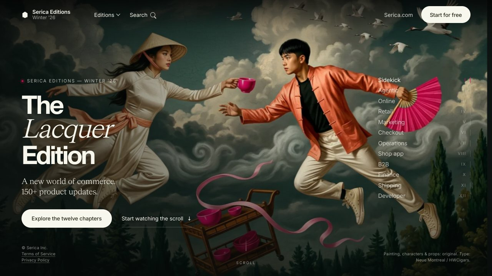
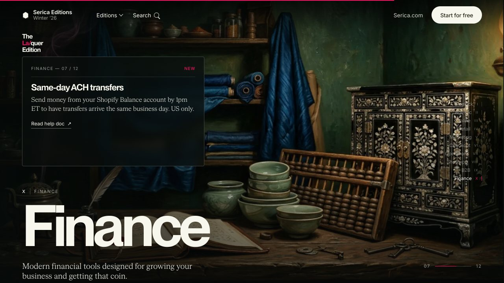
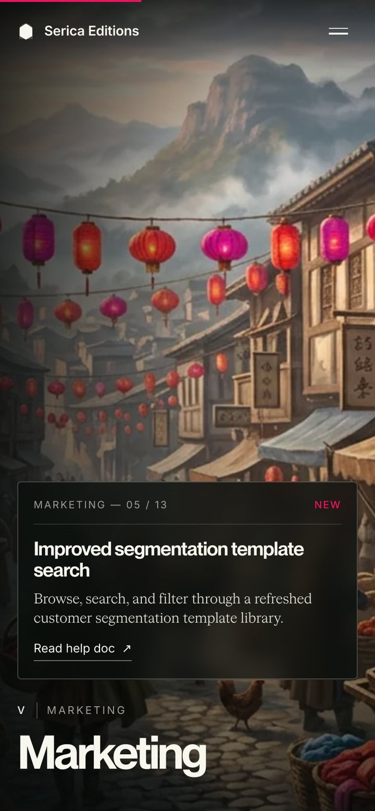
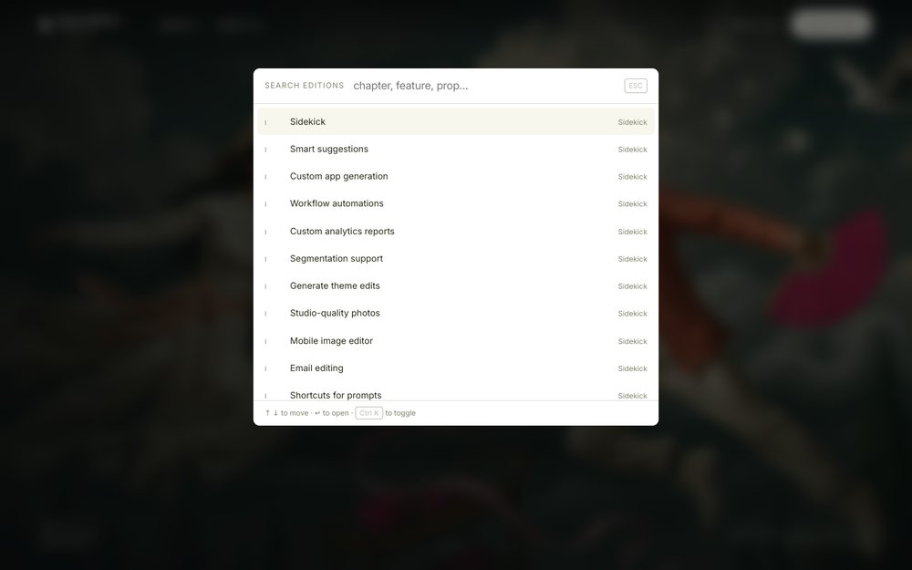

# SERICA — The Lacquer Edition

A second reading of the same page, with a different cast.

`serica/` rebuilds the **Shopify Editions Winter ’26** homepage — same structure,
same design language, same interactions — as *Serica Editions, The Lacquer
Edition*: an East-Asian / Vietnamese Renaissance where the two floating figures
become dancers in silk *áo dài*, the magenta shopping bag becomes a glazed
teacup, the skateboard becomes a floating lacquer tea cart, and every chapter
painting is replaced.

Everything else is kept:

- the fixed bar (brand, Editions dropdown, Search, CTA), the mega roman-numeral
  chapter rail, the small "The Ren//ssance Edition" lockup, the footer legal
  block;
- the sticky-scene scroll: twelve chapters, each pinned for its own scroll
  length, feature panels cross-fading one at a time, painting drifting under
  the type, giant chapter wordmark at the bottom, quote band between scenes;
- the paper `#F7F7EE` / ink `#292919` band, hairlines instead of shadows,
  the single magenta accent `#EA1360`, display type at negative tracking;
- the copy itself: chapter leads and all 199 feature titles/descriptions are the
  original text, verbatim (`js/content.js`, generated from
  `snapshot/page-content.json`).

## Preview

| | |
|---|---|
|  |  |
|  |  |

## Run

```bash
python3 -m http.server 4180 --directory serica --bind 0.0.0.0
# http://127.0.0.1:4180/
```

No build step, no network requests: fonts, art and icons are local.

## Map

| Path | What it is |
|---|---|
| `index.html` | markup: bar, hero, chapter host, outro, search dialog, mobile nav |
| `css/serica.css` | tokens + layout + responsive rules (original code, no Shopify CSS) |
| `js/content.js` | generated chapter copy (12 chapters, 199 features) |
| `js/serica.js` | scroll engine: sticky chapters, panel timeline, rails, ⌘K search |
| `img/art/` | the twelve chapter paintings + hero, sized WebP |
| `img/raw/` | the original generations, JPEG (source of truth) |
| `fonts/` | display / serif / UI / script woff2 subsets |
| `tools/art.py` | raw → WebP pipeline (`python3 serica/tools/art.py`) |

## Interaction inventory

- **Scroll**: Lenis-free lerped scroll, `requestAnimationFrame` loop; a chapter
  becomes active when its sticky frame reaches the top, and `progress × features`
  picks the panel. Hero art parallaxes and fades; the bar flips to paper while a
  light band is under it.
- **Chapter rail**: numerals I–XII in the hero, repeated inside every chapter;
  the active numeral turns magenta. Clicking jumps to that chapter.
- **Search**: `⌘K` / `Ctrl K` / `/` opens the palette, which indexes all twelve
  chapters and 199 features; `↑ ↓ ↵` work.
- **Editions dropdown**: opens under the brand lockup, closes on outside click.
- **Mobile**: burger nav, panels collapse to one card above the wordmark,
  rails hidden, hero lockup shrinks.
- **`prefers-reduced-motion`**: transitions and parallax are switched off.

## Art direction

Oil on canvas, chiaroscuro, museum lighting — the painting carries the colour,
the interface stays neutral, and magenta appears only on a prop:

| Chapter | Character | Prop in magenta |
|---|---|---|
| Hero | two silk dancers, cranes, storm clouds | teacup, folding fan, tea-cart bowls |
| Sidekick | masked writer at a rosewood desk | silk fan |
| Agentic | scholar in a scroll library | – (brass astrolabe, plum blossom) |
| Online | painter at an easel, silk screen | brush |
| Retail | merchant's shop at night | incense smoke |
| Marketing | lantern market at dawn | cloth banner |
| Checkout | woman by a mountain lake | lacquer envelope |
| Operations | warehouse compound | – (red seals) |
| Shop app | night-market stall | parasols |
| B2B | trade-route map room | – (silk route map) |

## Notes

- Copy and information architecture come from the capture in `snapshot/`; the
  paintings, characters and props are newly generated for this study.
- Not a Shopify product, page or template, and not a redistribution of their
  artwork. See the scope note in the root `README.md`.
