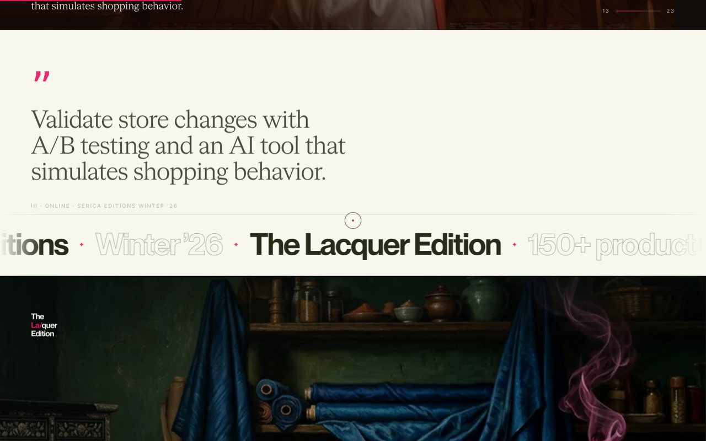

# SERICA — The Lacquer Edition

A second reading of the same page, with a different cast.

`serica/` rebuilds the **Shopify Editions Winter ’26** homepage — same structure,
same design language, same motion grammar — as *Serica Editions, The Lacquer
Edition*: an East-Asian / Vietnamese Renaissance where the two floating figures
become dancers in silk *áo dài*, the magenta shopping bag becomes a glazed
teacup, the skateboard becomes a floating lacquer tea cart, and every chapter
painting is replaced.

## Preview

| hero | chapter |
|---|---|
|  |  |

| quote band | search (⌘K) |
|---|---|
|  |  |


## Run

```bash
python3 -m http.server 4173 --directory serica --bind 0.0.0.0
# http://127.0.0.1:4173/
```

No build step, no network requests: fonts, art and icons are local.

## Motion inventory (rebuilt, not copied)

| Behaviour | How it is built |
|---|---|
| **Preloader** | count 000 → 100, two black lacquer curtains split, hero painting unmasks (`clip-path`) and the title lines rise out of their masks |
| **Smooth scroll** | native scroll, with every scene value eased toward the page (`lerp` follower) and `scroll-behavior: smooth` for anchors — no scroll hijacking, so sticky scenes stay on their own layer |
| **Title reveal** | each chapter word is wrapped in an overflow mask; on scene entry the inner span rises 115% with a 2° unwind, staggered |
| **Lead copy** | split into words, each rising with a `--d` delay cascade |
| **Scene entrance** | painting settles from `scale 1.14 → 1.03` (1.8 s), scrim lifts 0.62 → 1, key light fades in — fires once per chapter, not per frame |
| **Scroll timeline** | the chapter's scroll span is divided across its feature panels; the active card cross-fades in while the previous one lifts away, children stagger `--i × 70 ms` |
| **Counter / progress** | `01 / 19` counter + magenta bar track the panel index; a 2 px hairline at the top tracks the page |
| **Rail** | I–XII in the hero and repeated in every chapter; active numeral turns magenta with a dot, jumps use the transit wipe |
| **Transit wipe** | magenta band sweeps in, page jumps under cover, band retracts (looks like a view transition, but needs no API) |
| **Nav** | hides on scroll down, returns on scroll up, flips to ink-on-paper over light bands |
| **Ticker** | two marquee bands (hero + each quote band) run on their own clock and speed up with scroll velocity |
| **Pointer** | ring cursor trails the pointer, magnetic buttons pull toward it, cursor dot is instant |
| **Quote bands** | paper band between scenes, copy drifts slower than the page, ticker underneath |
| **Search** | `⌘K` / `Ctrl K` / `/`, indexes 12 chapters + 199 features, `↑ ↓ ↵`, live filter |
| **Mobile** | burger sheet that sits above the bar, one card above the wordmark, rails hidden |
| **Reduced motion** | preloader, wipe, cursor and all transforms are switched off; content is always visible |

Verified in headless Chromium at 1440×900, 1280×720, 1680×1050 and 390×844:
no console errors, panel counts 199, chapter count 12, rail jumps land on the
chapter's first frame.

## Map

| Path | What it is |
|---|---|
| `index.html` | markup: preloader, bar, hero, chapter host, outro, search, mobile sheet |
| `css/serica.css` | tokens, layout, motion classes, responsive + short-viewport rules |
| `js/content.js` | generated chapter copy (12 chapters, 199 features) |
| `js/serica.js` | the motion engine (one rAF loop, scene registry, search, nav) |
| `img/art/` | the twelve chapter paintings + hero, sized WebP |
| `img/raw/` | the original generations, JPEG (source of truth) |
| `fonts/` | display / serif / UI / script woff2 subsets |
| `tools/art.py` | raw → WebP pipeline (`python3 serica/tools/art.py`) |

## Art direction

Oil on canvas, chiaroscuro, museum lighting — the painting carries the colour,
the interface stays neutral, and magenta appears only on a prop:

| Chapter | Character | Prop in magenta |
|---|---|---|
| Hero | two silk dancers, cranes, storm clouds | teacup, folding fan, tea-cart bowls |
| Sidekick | masked writer at a rosewood desk | silk fan |
| Agentic | scholar in a scroll library | – (brass astrolabe, plum blossom) |
| Online | painter at an easel, silk screen | brush |
| Retail | merchant's shop at night | incense smoke |
| Marketing | lantern market at dawn | cloth banner |
| Checkout | woman by a mountain lake | lacquer envelope |
| Operations | warehouse compound | – (red seals) |
| Shop app | night-market stall | parasols |
| B2B | trade-route map room | – (silk road map) |
| Finance | moneychanger's table *(stand-in: retail painting, duotone sibling)* | silk cloth |
| Shipping | harbour at dawn *(stand-in: mirrored checkout painting)* | flag |
| Developer | codex ink study *(stand-in: duotone B2B painting)* | chalk accent |

Chapters 10–12 are wired but still use graded derivatives of neighbouring
paintings; regenerate them with `generate_image` and re-run `tools/art.py` when
the image budget allows — the file names already match.

## Notes

- Copy and information architecture come from the capture in `snapshot/`; the
  paintings, characters and props are newly generated for this study.
- Not a Shopify product, page or template, and not a redistribution of their
  artwork. See the scope note in the root `README.md`.
